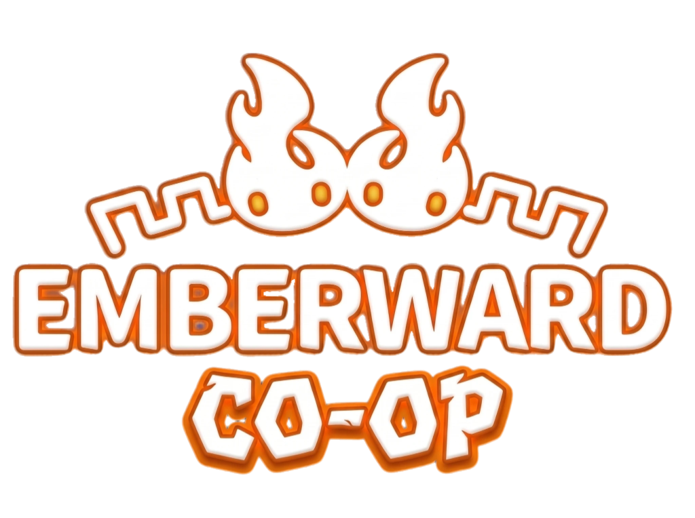

<p align="center">
  
</p>

# Emberward Co-op

Online P2P and Direct LAN co-op mod (2–4 players) for **Emberward**, built with BepInEx 6 (IL2CPP) and Harmony.

Hosts can run sessions over Steam P2P or Direct LAN using either a **Shared Resources** pool or **Separate Resources** with per-player economies and tower ownership. All match settings, worlds, difficulties, board actions, waves, modals, and quests stay synchronized across connected players while keeping client solo saves isolated.

---

## Features

- **Online Steam P2P & Direct LAN:** Host Friends-Only, Public, or Private Steam lobbies with lobby codes and Steam overlay invites, or host directly over LAN (TCP + UDP) with automatic LAN discovery. Lobby queries filter strictly for valid Emberward Co-op sessions.
- **Pre-Run Co-op Lobby:** Accessible from the title screen (`CO-OP` button or `F8`). The host configures the world/stage, difficulty, resource mode, and balance rules with live updates to all connected clients, while each player can pick a playable hero portrait avatar for the session.
- **Shared vs. Separate Resources:**
  - **Shared Resources:** Unified gold, energy, deck, and hand pool synced across the party with shared build, upgrade, and targeting control.
  - **Separate Resources:** Independent gold, hands, decks, and per-player tower/block ownership (color-coded base rings and read-only inspection on teammate towers), plus mid-run gold gifting and simultaneous independent or host-shared reward drafts and shops.
- **Session Rules & Presets:** Host-configurable multipliers for enemy HP, wave density, enemy speed, boss HP/armor, starting gold split, wave income scaling, shared turn block caps, core HP scaling, speed control permissions, and wave start policy. Includes four built-in presets (*Balanced Co-op*, *Casual*, *Tactical Hardcore*, *Chaos*) and JSON custom preset save/load.
- **Presence & Tactical Tools:** Color-coded remote player cursors, translucent ghost previews of hovered/rotated tetromino blocks and towers, contextual pings and a 5-slice ping wheel, grid-snapped maze path sketching, a 10-sticker emote wheel with 6 quick callouts, build-phase quick undo (`Ctrl+Z`), a collapsible in-run Players HUD with inline ping readouts and hover previews, and an auto-hiding social chat log. Camera panning and zooming lock while radial wheels or co-op modals are active.
- **Sync Safety & Progression:** Periodic state-hash checks with automatic resync, mid-wave auto-pause modal on peer disconnect, isolated client sessions so solo saves are not overwritten (while XP, codex records, and achievements still commit to the client's profile), and a post-run contribution breakdown on victory/defeat screens.
- **In-Game Mod Settings & Localization:** Rebind hotkeys and adjust HUD compactness, sticker scale/volume, mute toggles, and disconnect auto-pause from `Pause -> CO-OP SETTINGS` or the Lobby `Mod Settings` button. Automatically follows Emberward's active language across 10 languages (`en`, `de`, `es`, `fr`, `ja`, `ko`, `pt-BR`, `ru`, `zh-CN`, `zh-TW`) using editable JSON files in `Languages/`.

---

## Prerequisites & Requirements

Before installing the mod, make sure the following prerequisites are in place:

| Requirement | Details |
| :--- | :--- |
| **Emberward** | Steam PC version (Unity `2022.3.62f2` IL2CPP). Tested on Steam build `26835875` (`1.1.0`). |
| **BepInEx 6 (Unity.IL2CPP x64)** | Required mod loader. Tested on [`6.0.0-be.789`](https://builds.bepinex.dev/projects/bepinex_be) (`.NET 6.0.7` IL2CPP runtime). |
| **Steam Client** | Required only for **Online (Steam P2P)** lobbies and friend invites. **Direct LAN** works without Steam. |
| **.NET 6.0+ SDK** *(Source builds only)* | Only needed if compiling from source ([Microsoft .NET Downloads](https://dotnet.microsoft.com/download)). |

### Setting Up BepInEx 6 (First-Time Only)

1. Download the latest **`BepInEx-Unity.IL2CPP-win-x64`** archive from the [BepInEx 6 Bleeding Edge Builds](https://builds.bepinex.dev/projects/bepinex_be) page.
2. Extract its contents directly into your **Emberward** root folder (the folder containing `Emberward.exe`).
3. Launch Emberward once to let BepInEx generate `BepInEx/interop/`, then close the game.

---

## Installation

All players in a session must have the same mod version installed.

1. Download **`EmberwardCoop-v1.0.0.zip`** from the [Releases](https://github.com/HyruleChosenOne/Emberward-Coop/releases) page.
2. Extract the archive directly into your **Emberward** root folder (where `Emberward.exe` is located) so the plugin files land at:
   ```text
   Emberward/
   └── BepInEx/
       └── plugins/
           └── EmberwardCoop/
               ├── EmberwardCoop.dll
               └── Languages/
                   ├── de.json
                   ├── en.json
                   ├── es.json
                   ├── fr.json
                   ├── ja.json
                   ├── ko.json
                   ├── pt-BR.json
                   ├── ru.json
                   ├── zh-CN.json
                   └── zh-TW.json
   ```
3. Launch Emberward and click **CO-OP** on the title screen (or press **`F8`**) to host or join a lobby.

> **Direct LAN ports:** Hosting on LAN uses TCP port `27777` (configurable), UDP `port + 1` for cursor/ghost updates, and UDP `27778` for automatic LAN discovery.

---

## Default Controls

All primary bindings can be changed in-game via **Pause -> CO-OP SETTINGS** or the Lobby **Mod Settings** button (saved to `BepInEx/config/com.emberward.coop.cfg`).

| Action | Default Input | Notes |
| :--- | :--- | :--- |
| **Toggle Co-op Lobby** | `F8` | Opens/closes the pre-run lobby on the title screen |
| **Toggle Players HUD** | `F7` | Collapses or expands the in-run Players HUD |
| **Emote / Sticker Wheel** | `T` | Tap to click a sticker, or hold & release on a slice; `Tab` or scroll wheel switches to Callouts (`1`–`6` fire directly) |
| **Smart Ping / Ping Wheel** | `Middle Mouse` | Tap for a context-aware ping; hold to open the 5-slice tactical wheel |
| **Quick Tactical Pings** | `F1` – `F5` | Direct pings at cursor: Build Maze (`F1`), Place DPS (`F2`), Need Gold (`F3`), Upgrade/Focus (`F4`), Watch Lane (`F5`) |
| **Maze Path Sketching** | `Left Alt + Left Drag` | Draws a temporary tile-snapped directional path visible to teammates |
| **Build-Phase Quick Undo** | `Ctrl + Z` | Undoes your last tower or block placement within the build-phase grace window (full refund/card return) |

---

## Building from Source

1. Install the [.NET 6.0+ SDK](https://dotnet.microsoft.com/download).
2. Ensure **Emberward** has been launched at least once with **BepInEx 6 (Unity.IL2CPP x64)** so `dotnet/`, `BepInEx/core/`, and `BepInEx/interop/` exist in your game directory.
3. Point MSBuild to your Emberward installation using any of the following:
   - Copy `EmberwardCoop.csproj.user.example` to `EmberwardCoop.csproj.user` and edit `<EmberwardDir>`.
   - Set the `EmberwardDir` environment variable.
   - Pass `-p:EmberwardDir="C:\Path\To\Emberward"` on the command line.
4. Build the Release binary:
   ```powershell
   dotnet build EmberwardCoop.csproj -c Release
   ```
   The compiled `EmberwardCoop.dll` and `Languages/` folder are output to `bin/Release/`. Copy both into `<EmberwardDir>/BepInEx/plugins/EmberwardCoop/`.

---

## Credits

- **[Hyrule (`HyruleChosenOne`)](https://github.com/HyruleChosenOne)** — Mod creator and maintainer.
- **ReficGames** — Developers of *Emberward*.
- **BepInEx, HarmonyX, Il2CppInterop & MonoMod contributors** — Unity IL2CPP modding framework and runtime patching infrastructure.
- **Steamworks.NET (`rlabrecque`)** — Steamworks C# wrapper bundled with Emberward.

---

## Disclaimer & License

This is an unofficial community mod and is not affiliated with, endorsed by, or supported by ReficGames.

Licensed under the [MIT License](LICENSE).
